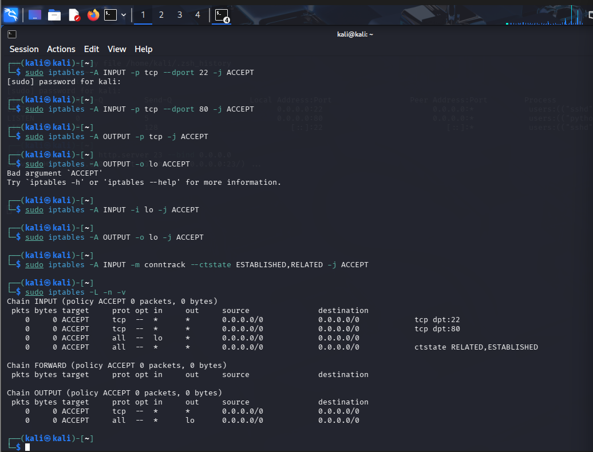
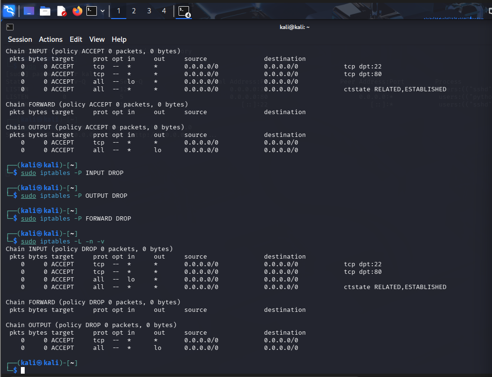
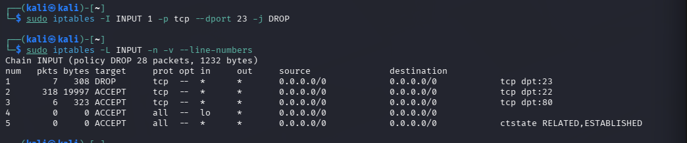
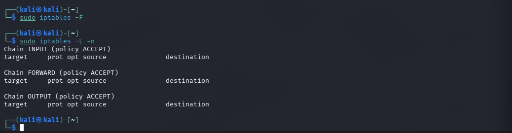

# Linux Firewall Configuration and Testing Using iptables

## Overview

This project demonstrates the configuration and testing of a Linux firewall using iptables on Kali Linux.

The objective was to control network traffic by allowing specific services, blocking unauthorized connections, and verifying firewall behavior through practical testing.

## Tools and Technologies

- Kali Linux
- Linux iptables
- Oracle VirtualBox
- Windows PowerShell
- SSH and HTTP
- TCP/IP Networking

## Lab Implementation

### 1. Initial Configuration

- Inspected the existing firewall rules.
- Identified the Kali Linux IP address.
- Started SSH and HTTP services.
- Configured VirtualBox NAT port forwarding.
- Verified connectivity before applying firewall restrictions.

### 2. Firewall Configuration

- Allowed incoming SSH traffic on TCP port 22.
- Allowed incoming HTTP traffic on TCP port 80.
- Allowed outgoing TCP traffic.
- Allowed loopback and established connections.
- Applied default DROP policies to INPUT, OUTPUT, and FORWARD.

### 3. Firewall Testing

- Verified successful SSH connectivity after applying firewall rules.
- Confirmed HTTP access with an HTTP 200 OK response.
- Demonstrated TCP port 23 blocking using connection tests and firewall packet counters.

### 4. Firewall Cleanup

- Restored default policies to ACCEPT.
- Flushed the firewall rules.
- Verified the final configuration.
- Closed test sessions and stopped temporary services.

## Test Results

| Test | Expected Result | Observed Result |
|------|-----------------|-----------------|
| SSH (Port 22) | Allowed | Successful login |
| HTTP (Port 80) | Allowed | HTTP 200 OK |
| TCP Port 23 | Blocked | Request timed out; DROP counter recorded packets |
| Firewall Cleanup | Rules removed | Successfully restored |

## Implementation Screenshots

### 1. Firewall Allow Rules

Configured rules to permit SSH, HTTP, outgoing TCP, loopback traffic, and established connections.

### 2. Default DROP Policies

Applied default DROP policies to the INPUT, OUTPUT, and FORWARD chains.

### 3. TCP Port 23 Blocking

Verified blocked TCP port 23 traffic using firewall packet counters.

### 4. Firewall Cleanup

Restored default ACCEPT policies and flushed the configured firewall rules.

## Key Skills Demonstrated

- Linux Firewall Administration
- Network Security
- iptables Configuration
- Network Access Control
- TCP/IP Networking
- Firewall Testing and Troubleshooting

## Full Project Report

[View Full Lab Report](Network%20Security%20.pdf)

## Note

This project was implemented in a virtual lab environment for educational purposes.
